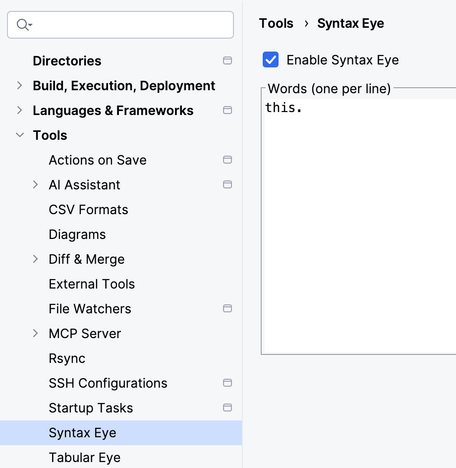
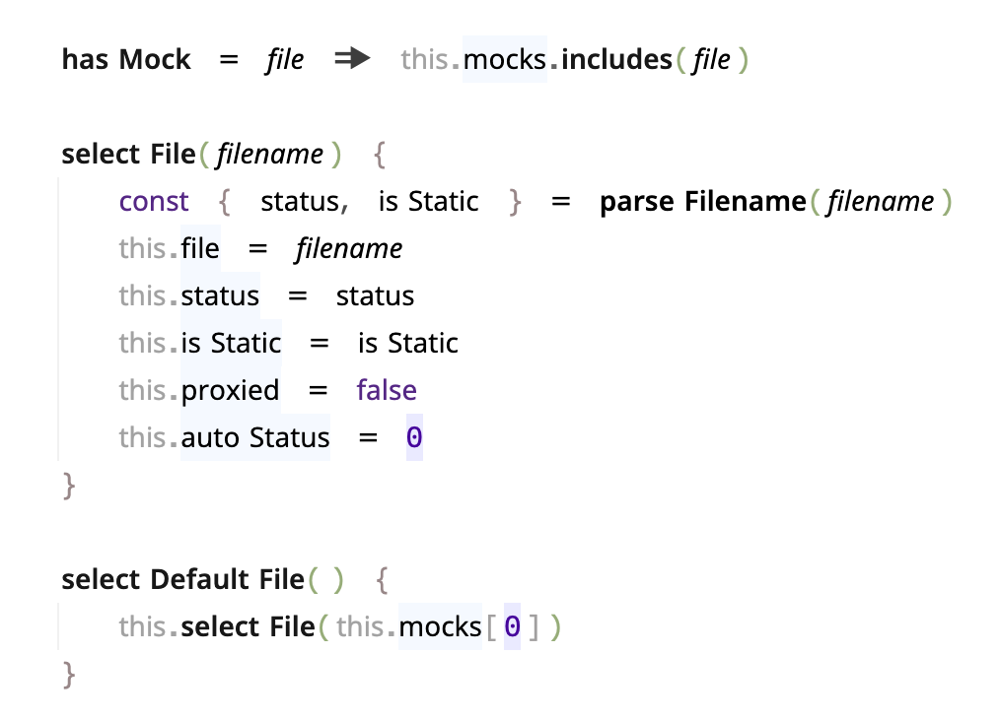

# Syntax Eye

https://plugins.jetbrains.com/plugin/35646-syntax-eye

<!-- Plugin description -->
Lets you add a configurable
syntax highlight style (Faint Text) to a list of predefined words.

For example, in the nginx code base there are a lot of `NGX_` prefixes,
so I make them faint so I can scan the code faster. 
Similarly, for `this` in JS or `self` in Python.
<!-- Plugin description end -->

## Config 
Say we want to reduce the visual weight of `this.` in JS.

### Settings


### Example



## Development

```sh
./gradlew runIde
```

```sh
./gradlew buildPlugin
```
The resulting ZIP:
`build/distributions/syntax-eye-1.0-SNAPSHOT.zip`

--- 
Plugin based on the [IntelliJ Platform Plugin Template][template].

[template]: https://github.com/JetBrains/intellij-platform-plugin-template

[docs:plugin-description]: https://plugins.jetbrains.com/docs/intellij/plugin-user-experience.html#plugin-description-and-presentation

